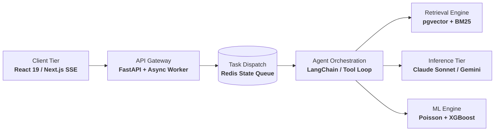

<div align="center">

<!-- Semantic SEO Metadata (Hidden for search engines & crawler indexing) -->
<!--
Author: Bildad Mwangi
Title: Bildad Mwangi | AI/ML Systems Engineer & Full-Stack Architect
Keywords: Bildad Mwangi, Kenyatta University, AI Engineer Kenya, ML Systems, Agentic AI, LangChain, RAG Architectures, FastAPI, React 19, Next.js, Solidity, MNUC Market, BetEdge Pro, DeVote, Nairobi Tech
Canonical Portfolio: https://bildadmwangi.tech
Campus Marketplace: https://mnucmarketplace.me
GitHub: https://github.com/JB7-creator
-->

<!-- Hero Cyber-Luxe Waving Banner in Electric Light Blue & Obsidian -->


<!-- Dynamic Typewriter Animation with Light Blue & Gold Accents -->
<a href="https://github.com/JB7-creator">
  
</a>

<p align="center">
  <a href="https://bildadmwangi.tech"></a>
  <a href="https://mnucmarketplace.me"></a>
  
  <a href="mailto:billyelcie7@gmail.com"></a>
</p>

<!-- Core Technology Icons Strip -->
<p align="center">
  <a href="https://skillicons.dev">
    
  </a>
</p>

</div>

---

### EXECUTIVE OVERVIEW

I am a Computer Science student at **Kenyatta University (KU)**, an **AI/ML systems engineer**, and a **full-stack architect**. My work focuses on connecting probabilistic machine learning models, autonomous agentic loops, and high-throughput production web systems to solve critical real-world problems.

```text
┌────────────────────────────────────────────────────────────────────────┐
│                        CORE ENGINEERING DOMAINS                        │
├────────────────────────────────────────────────────────────────────────┤
│  Autonomous Agents   Grounded RAG            Statistical ML            │
│  Tool Orchestration  Multi-Tier State        FastAPI Async Serving     │
│  Full-Stack React 19 Solidity Web3 Contracts PostgreSQL / pgvector    │
└────────────────────────────────────────────────────────────────────────┘
```

---

### OPPORTUNITIES & COLLABORATION

I am actively **ready and open** for:
* **AI/ML Engineering Roles & Internships** (Agentic pipelines, RAG systems, model evaluation, fine-tuning)
* **Full-Stack & Systems Engineering** (React 19 / Next.js, FastAPI, PostgreSQL/pgvector, async microservices)
* **Applied AI Research & Startup MVPs** (Transforming research prototypes into scalable commercial products)

> *Have a project, role, or vision to build? Reach out directly via **[billyelcie7@gmail.com](mailto:billyelcie7@gmail.com)** or explore my custom domain portfolio at **[bildadmwangi.tech](https://bildadmwangi.tech)**.*

---

### SYSTEM ARCHITECTURE: GROUNDED MULTI-AGENT RAG & ML PIPELINE



---

### PRODUCTION FLAGSHIPS & CASE STUDIES

| Flagship Platform | Domain & Architecture | Engineering Highlight | Live Links |
| :--- | :--- | :--- | :---: |
| **MNUC Market** | `Campus E-Commerce` `Supabase` `Cloudinary` `Netlify` `M-Pesa` | **Multi-tenant student marketplace for Mama Ngina University College (MNUC).** Full auth, real-time catalog search, Cloudinary media CDN, and serverless Netlify functions for M-Pesa Daraja payment workflows. | [Live Site (mnucmarketplace.me)](https://mnucmarketplace.me) |
| **BetEdge Pro** | `Python` `XGBoost` `Scikit-Learn` `Streamlit` `Poisson Math` | **AI sports predictive modeling system.** Implements bivariate Poisson probability density modeling with an ensemble XGBoost classifier to isolate positive expected value (EV) betting opportunities. | [Repository](https://github.com/JB7-creator/betting-bot) |
| **DeVote** | `Solidity 0.8` `Hardhat` `React 18` `Tailwind` `Ethers.js` | **Cryptographic decentralized voting platform.** Eliminates centralized election fraud through immutable on-chain smart contracts and cryptographic ballot verification. | [Repository](https://github.com/JB7-creator/blockchain-voting-system) |
| **Rukwaro Autospares** | `React 19` `TypeScript` `Supabase` `Vite` `Tailwind` | **Production automotive parts storefront.** High-throughput digital catalog with client-side faceted filtering over hundreds of SKUs and Supabase row-level security. | [Repository](https://github.com/JB7-creator/Rukwaroautospares) |
| **Autonomous RAG Agent** *(R&D)* | `Python` `LangChain` `FastAPI` `pgvector` `PostgreSQL` | **Grounded document synthesis engine.** Multi-document hybrid search combining dense vector embeddings with BM25 lexical keyword search and citation grounding. | *Private R&D* |

---

### CORE COMPETENCIES MATRIX

<table>
  <tr>
    <td width="50%" valign="top">
      <h4>AI, Machine Learning & Agents</h4>
      
      
      
      
      
      
    </td>
    <td width="50%" valign="top">
      <h4>Backend, Systems & Data</h4>
      
      
      
      
      
      
    </td>
  </tr>
  <tr>
    <td width="50%" valign="top">
      <h4>Frontend & Architecture</h4>
      
      
      
      
      
    </td>
    <td width="50%" valign="top">
      <h4>Web3 & Distributed Tools</h4>
      
      
      
      
      
    </td>
  </tr>
</table>

---

### LIVE ACTIVITY & METRICS TELEMETRY

<div align="center">

<!-- Live Dynamic Contribution Activity Wave Graph -->


<br/><br/>

<table border="0">
  <tr>
    <td>
      
    </td>
    <td>
      
    </td>
  </tr>
</table>

<!-- Streak Stats Card -->


</div>

<br/>

<div align="center">

<!-- Footer Waving Ribbon in Electric Blue and Obsidian -->


</div>
