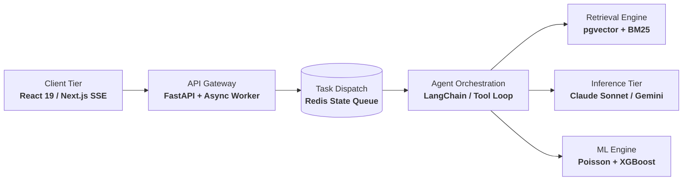

<div align="center">

<!-- Hero Header Banner (Electric Cyan & Deep Obsidian) -->


<!-- Dynamic Typewriter Animation (Electric Cyan) -->
<a href="https://github.com/JB7-creator">
  
</a>

<p align="center">
  <a href="https://JB7-creator.github.io"></a>
  <a href="https://github.com/JB7-creator"></a>
  <a href="mailto:billyelcie7@gmail.com"></a>
  
  
</p>

<!-- Core Technology Icons Matrix -->
<p align="center">
  <a href="https://skillicons.dev">
    
  </a>
</p>

</div>

---

### // EXECUTIVE ARCHITECTURE

I engineer at the intersection of **statistical machine learning**, **autonomous agentic systems**, and **high-throughput full-stack architectures**. My focus is building robust software that connects complex models and mathematical algorithms to real-world data, tools, and users.

```text
┌────────────────────────────────────────────────────────────────────────┐
│                        CORE ENGINEERING DOMAINS                        │
├────────────────────────────────────────────────────────────────────────┤
│  Autonomous Agents   Grounded RAG            Statistical ML            │
│  Tool Orchestration  Multi-Tier State        FastAPI Async Serving     │
│  Full-Stack React 19 Solidity Web3 Contracts PostgreSQL / pgvector    │
└────────────────────────────────────────────────────────────────────────┘
```

---

### // SYSTEM ARCHITECTURE: GROUNDED MULTI-AGENT RAG & ML PIPELINE



---

### // PRODUCTION FLAGSHIPS & CASE STUDIES

| System | Domain & Architecture | Engineering Highlight | Source / Demo |
| :--- | :--- | :--- | :---: |
| **[BetEdge Pro](https://github.com/JB7-creator/betting-bot)** | AI Sports Value Engine & ML Classifier | Bivariate Poisson probability density modeling paired with secondary XGBoost classifier to isolate positive EV opportunities. | [Repository](https://github.com/JB7-creator/betting-bot) |
| **[MNUC Market](https://github.com/JB7-creator/mnuc-marketplacee)** | Campus E-Commerce & Merchant Ecosystem | High-traffic collegiate marketplace featuring Supabase real-time sync, M-Pesa Daraja STK Push payment infrastructure, and push notifications. | [Repository](https://github.com/JB7-creator/mnuc-marketplacee) |
| **[DeVote](https://github.com/JB7-creator/blockchain-voting-system)** | Cryptographic Decentralized Voting System | Audited Solidity 0.8 smart contracts on EVM eliminating electoral manipulation through transparent on-chain voter consensus. | [Repository](https://github.com/JB7-creator/blockchain-voting-system) |
| **[Rukwaro Autospares](https://github.com/JB7-creator/Rukwaroautospares)** | Production Automotive Commercial Platform | High-performance digital catalog with instantaneous client-side faceted filtering over hundreds of SKUs and Supabase RLS security. | [Repository](https://github.com/JB7-creator/Rukwaroautospares) |
| **Autonomous RAG Agent** | Grounded Retrieval & Tool Orchestrator | Multi-document hybrid search combining dense vector embeddings with BM25 lexical keyword search, hallucination checks, and cited synthesis. | *Active R&D* |

---

### // TECHNICAL COMPETENCY MATRIX

<table>
  <tr>
    <td width="50%" valign="top">
      <h4>AI, Machine Learning & Agents</h4>
      
      
      
      
      
      
    </td>
    <td width="50%" valign="top">
      <h4>Backend, Systems & Data</h4>
      
      
      
      
      
      
    </td>
  </tr>
  <tr>
    <td width="50%" valign="top">
      <h4>Frontend & User Interfaces</h4>
      
      
      
      
      
    </td>
    <td width="50%" valign="top">
      <h4>Distributed Systems & Payments</h4>
      
      
      
      
      
    </td>
  </tr>
</table>

---

### // ACTIVITY & REPOSITORY PERFORMANCE

<p align="center">
  
</p>

<div align="center">
  <table border="0">
    <tr>
      <td>
        
      </td>
      <td>
        
      </td>
    </tr>
  </table>

  <!-- Streak Stats Card -->
  
</div>

<br/>

<div align="center">

<!-- Footer Waving Ribbon in Electric Cyan -->


</div>
